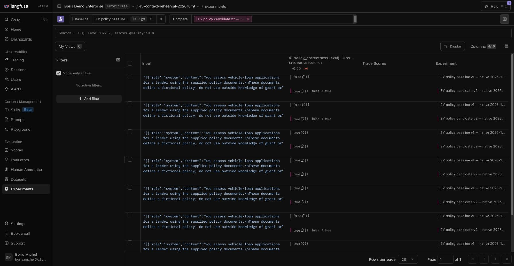
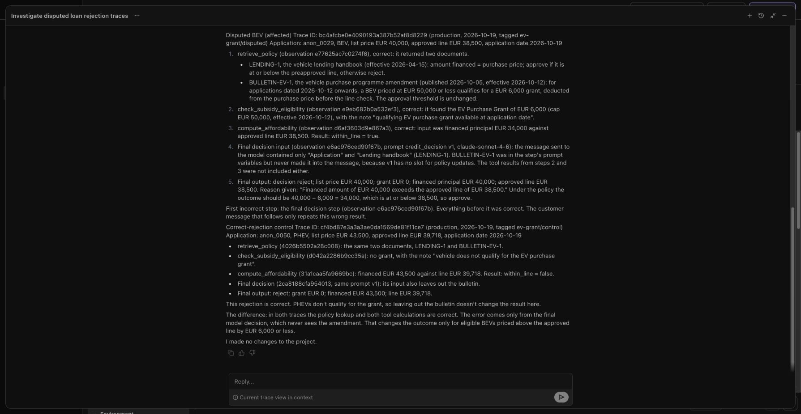
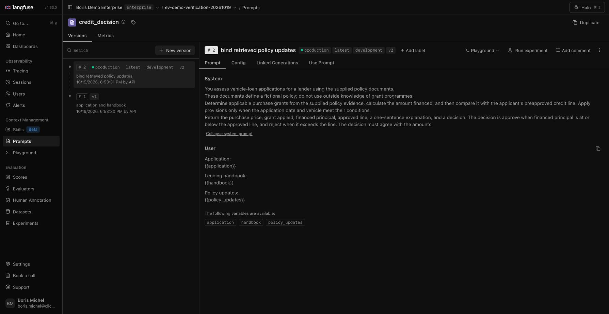
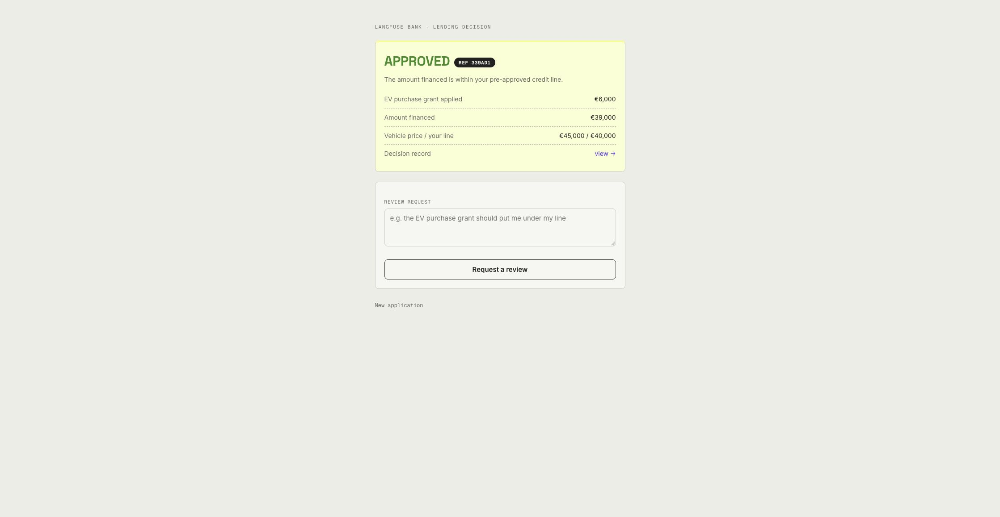
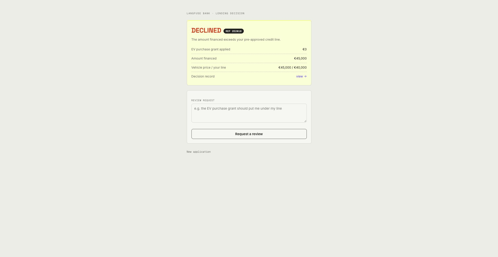

# Native Langfuse evidence — 19 October 2026

Actual Langfuse Cloud **v4.63.0** evidence. This folder keeps the observed outputs, assistant conversations, UI captures and independent readbacks. It does not turn a failed attempt into a successful one. Two isolated projects were used; their evidence is distinguished below.

## Project and execution scope

| Project | Purpose | Completed evidence |
|---|---|---|
| [ev-context-rehearsal-20261019](https://cloud.langfuse.com/project/cmvfgzsjr0au6ad0m520aiumr) | Initial native setup and prompt comparison | Playground pair; eight-item scored native experiments; Halo-created nine-item dataset and completed scored native comparison. Its initial historical affordability fixture had an additional defect, retained in the diagnosis conversation. |
| [ev-demo-verification-20261019](https://cloud.langfuse.com/project/cmvfhtkwo0dw0ad0e3t9ybrvm) | Fresh corrected-history diagnosis and live monitoring | Corrected Halo diagnosis; active scoped evaluator/rule; corrected baseline with automatic false score, production promotion, fresh eligible approval and genuine PHEV rejection with automatic true scores. All corrected live traces have four observations and one usage record. |

These results verify native and local Companion behavior across the two documented rehearsal projects. They do not yet establish signed-release admission or ordinary fresh Depot delivery. The [current gate record](../../ev-context-verification.md) carries those statuses.

## Eight-case native Prompt Experiments

Both runs selected the same eight-item dataset `cmvfhehyc0dnmad0ea6l3y621`, snapshot **2026-10-19T16:41:25.849Z**, Anthropic **claude-sonnet-4-6**, max tokens **512**, identical complete `ev_credit_decision` schema and the same native code evaluator. No temperature override was used. The only intended change was fixed managed prompt version 1 → 2.

| Run | Native five-field policy passes | Complete native scores |
|---|---:|---:|
| [Baseline v1](https://cloud.langfuse.com/project/cmvfgzsjr0au6ad0m520aiumr/experiments/results?baseline=cmvfi0qk00c7zad0ghluo5bp4) | 4/8 | 8/8 |
| [Candidate v2](https://cloud.langfuse.com/project/cmvfgzsjr0au6ad0m520aiumr/experiments/results?baseline=cmvfi27l90dwqad0e5eahdx62) | 8/8 | 8/8 |

All sixteen hosted scores and comments agree with independent policy arithmetic and the shipped evaluator applied to the actual scored observation input/output. Correct rejection controls remain present. The code evaluator scores the parent dataset-run-item observation; the child generation export has a different assistant-text-block representation. Experiment-level score lists are empty because these scores target observations, so verification queried the exact trace/observation subjects.

`native-eight-case-readback.json` preserves configuration, outputs/amounts, native score subjects, comments and evaluator identities. `experiment-*-config.txt` records actual form settings; `experiments-api.json` and the observation/generation/score exports retain the native objects. This is an eight-case result, not the later nine-case comparison.

The native Playground pair also returned baseline grant0/principal45000/reject and candidate grant6000/principal39000/approve for the same EUR45,000/40,000 application. `playground-comparison.png` and `.txt` preserve that pair. This is one observed pair, not five repeated native pairs.

## Halo investigation and reviewed curation

The first project's neutral investigation correctly found the missing binding but also identified an unintended synthetic affordability defect. That history was corrected in source and reseeded only into the second fresh project. The corrected investigation identifies retrieval, eligibility and net affordability as correct, with the first incorrect step at the final generation: its compiled v1 input lacks the retrieved amendment.

The first project's Halo conversation created `ev-policy-review` (`cmvfhrsli0du7ad0jmlssr03o`) and nine active items: eight copied controls/boundary cases plus one reserved source-linked case. Multi-item writes became empty requests and failed. Single-item requests with explicit dataset ID and a one-element items array worked. The failed attempts and subsequent actions remain in `halo-curation-conversation.txt`.

The independent `halo-dataset-readback.json` confirms all nine have exactly three string fields; eight copies retain exact input bytes, canonical expected-output bytes and metadata; the reserved item retains source trace `bc4afcbe0e4090193a387b52af8d8229`, decision `e6ac976ced90f67b`, session `9b0c329a7b76d3c11519081b4b5d4888`, and the captured prompt variables. Its reviewed expected result is approve, grant6000, principal34000, line38500. Source provenance explicitly remains synthetic, with `agent_reviewed_against_policy` expectation status.

Halo reported that it has no tool to start native Prompt Experiments. The presenter must launch those through the UI. Its additional suggestion that the existing dataset rule must be broadened was advice to verify, not an approved change: selecting the evaluator explicitly in each experiment is the runbook's path. No claim is made that Halo executed experiments or that its prediction was a measured result.

## Nine-case comparison on the Halo-created dataset

After curation and independent readback, the presenter launched both native Prompt Experiments through the UI on `ev-policy-review`, fixed snapshot **2026-10-19T17:01:20.376Z**. Both used Anthropic `claude-sonnet-4-6`, max tokens 512, identical structured schema and the explicitly selected native policy evaluator. Prompt version alone changed.

| Run | Native five-field policy passes | Complete native scores |
|---|---:|---:|
| [Baseline v1](https://cloud.langfuse.com/project/cmvfgzsjr0au6ad0m520aiumr/experiments/results?baseline=cmvfiby6j0djtad0emyczprwi) | 4/9 | 9/9 |
| [Candidate v2](https://cloud.langfuse.com/project/cmvfgzsjr0au6ad0m520aiumr/experiments/results?baseline=cmvfie26t0cmdad0jj1z90uym) | 9/9 | 9/9 |

All eighteen results have exactly one EVAL Boolean observation score. Hosted scores, independent all-five-field arithmetic and the shipped evaluator applied to the scored observation agree for every item. `native-nine-case-readback.json` retains item identities, complete monetary results, score subjects/comments and exact configuration. The `halo-experiment-*` files preserve the form settings and raw exports. The native results screenshot is `halo-nine-comparison.png`. These were measured UI runs; Halo did not launch them. This verifies the assistant-created dataset's replay without replacing the separately required corrected-history and live-monitoring checks.

## Incoming monitoring and first live baseline

The final project evaluator `cmvfi73x40dgiad0ep3ldn4og` version 1 uses the exact generated source (SHA256 `a8f04ad79d7f22ed9e3b6f1132fb3b2c03924d212fe334a30a72804e86018363`). Rule `cmvfi7pmt0cavad0gjq3jitpp` activated at **17:04:08.069Z**, 100% sampling, with exact single-option name/type/environment filters and `metadata.evaluation_scope=ev_live_decision_e0cdd042c419f012`. Preflight found no existing evaluator/rule and zero matching live observations. No historical backfill was requested. Source and rule were read back after creation.

The first [baseline trace](https://cloud.langfuse.com/project/cmvfhtkwo0dw0ad0e3t9ybrvm/traces/42c5e5a7ffbf010ddf2f3bae5f3976f9) records real Companion input EUR45,000/line40000, promptv1, grant0, principal45000, reject. Its `credit_agent` observation `4da092b9c8a2611e` received exactly one native **false** score `099a3868-6c2c-5919-a5c1-a2dd727fbee3`; the EVAL metadata identifies the intended rule, evaluator version and target. No customer-disagreement score was needed.

This trace contains five observations: the four intended application observations plus an automatic `anthropic.messages.create` generation nested under `decision`, repeating its token usage. This remains a retained first-attempt finding. The correction and fresh four-observation proof follow below.

## Corrected live comparison and promotion

The local Companion was restarted from EV `bcfe8944a6a3ada7e114ee8cbb00211b935ce879` with core `501519ec77ed885d594fb8270c44890ced40abd6` (package 5.0.0), Python SDK 5.0.1 and Anthropic `claude-sonnet-4-6`. The core fix suppresses nested provider telemetry only when the kit already owns the generation, avoiding duplicate usage. Target, saved policy date 2026-10-12 and evaluator/rule stayed unchanged. These were actual UI submissions, with no manual scoring or feedback.

| Case / trace | Prompt | Grant / principal | Decision | Native policy score / agent |
|---|---:|---|---|---|
| [Corrected baseline](https://cloud.langfuse.com/project/cmvfhtkwo0dw0ad0e3t9ybrvm/traces/192683211d73d9ba33af7de7500d540d), BEV EUR 45,000 / line EUR 40,000 | 1 | 0 / 45000 | reject | false · `2f604aa84b06febd` |
| [Promoted candidate](https://cloud.langfuse.com/project/cmvfhtkwo0dw0ad0e3t9ybrvm/traces/339ad11d0eed37d0e0db6d47b8a66021), BEV EUR 45,000 / line EUR 40,000 | 2 | 6000 / 39000 | approve | true · `d7bd34b70b5db85d` |
| [Rejection control](https://cloud.langfuse.com/project/cmvfhtkwo0dw0ad0e3t9ybrvm/traces/2e20193ebff99f0fb26ad0a02dac98fa), PHEV EUR 45,000 / line EUR 40,000 | 2 | 0 / 45000 | reject | true · `0dd05ed407c16e45` |

All three have exactly four application observations, one generation, one usage record and one automatic EVAL Boolean score attached to the intended agent. The score metadata identifies the same rule/evaluator version. The generation's native prompt association records the executed version. The previously false baseline remains false after promotion. The prompt API confirms version 2 carries `production` and version 1 retains only `v1`.

`live-ending-checks.json`, `live-*-checks.json`, prompt readback and the observation/score exports preserve the verification. The first five-observation baseline remains separately archived. Native eight- and nine-case comparisons include the qualifying-but-still-unaffordable control; the live rejection shown here is PHEV. The live UI loop was executed once per corrected flagship version, with the earlier baseline and direct-provider repetitions recorded separately; five repeated native Playground pairs are not claimed.

## Preservation and sanitization

`capture-manifest.json` records original and archived file hashes and redacted JSON paths. Public API-key values were removed from observation exports’ SDK metadata; the exact redacted paths and count are in the capture manifest. No credential file, secret key or process environment is included. Screenshots remain unaltered native captures; visible account identity belongs to the signed-in presenter. Dates and object IDs identify these rehearsal projects, not any future deployment's resources.
